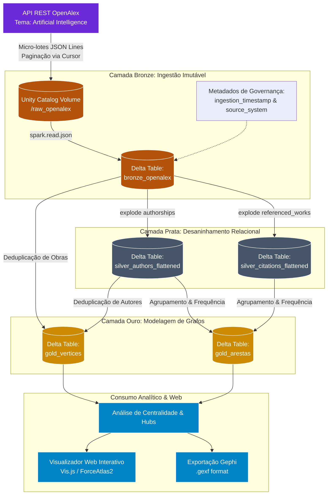

# 🚀 Pipeline de Engenharia de Dados em Arquitetura Medallion no Databricks para Modelagem de Grafos (OpenAlex)

> **Trabalho de Conclusão de Curso (TCC)**  
> **Curso:** Bacharelado em Ciência da Computação  
> **Instituição:** Escola Politécnica e de Artes — Pontifícia Universidade Católica de Goiás (PUC Goiás)  
> **Autor:** Diego de Paula Silva  
> **Orientador:** Prof. Me. Daniel Corrêa da Silva  

[](https://databricks.com)
[](https://spark.apache.org)
[](https://delta.io)
[](https://python.org)
[](https://openalex.org)

---

## 📌 1. Visão Geral do Projeto

A extração de conhecimento a partir de grandes acervos bibliométricos é fundamental para compreender a evolução da ciência e os padrões de colaboração acadêmica. O **OpenAlex** é um dos maiores catálogos mundiais de acesso aberto, indexando mais de **318 milhões de produções científicas**. Contudo, os dados brutos são fornecidos em arquivos **JSON semiestruturados e altamente aninhados** (árvores complexas de listas e dicionários).

### O Desafio de Engenharia de Dados:
A realização de consultas analíticas e a construção de redes relacionais de grafos (ex: *"encontrar todos os coautores de um pesquisador"*) diretamente sobre arquivos JSON semiestruturados acarreta:
* **Gargalo severo de I/O:** Necessidade de desserializar arquivos inteiros linha por linha na memória RAM;
* **Fricção Estrutural:** Risco constante de estouro de memória (*Out-Of-Memory - OOM*) ao quebrar matrizes aninhadas em tempo de consulta;
* **Latência Proibitiva para a Web:** Consultas simples chegam a levar **~29 segundos**, inviabilizando a renderização fluida de aplicações web em tempo real.

### A Solução Implementada:
Este projeto implementa um pipeline escalável sob a **Arquitetura Medallion** no ecossistema de nuvem do **Databricks** (Apache Spark e Delta Lake / Unity Catalog), convertendo dados brutos do OpenAlex em **estruturas colunares otimizadas de Vértices e Arestas** (Camada Ouro) prontas para o consumo analítico de grafos.

---

## 🏗️ 2. Arquitetura do Pipeline (Medallion Architecture)

O pipeline foi projetado em camadas de refinamento incremental para desacoplar a ingestão da lógica analítica:



---

## 📊 3. Resultados Experimentais e Benchmarks

O pipeline foi estressado contra uma base de **100.000 artigos científicos** de Inteligência Artificial para avaliar o ganho de eficiência da arquitetura Medallion frente à consulta em dados semiestruturados brutos:

| Métrica Avaliada | Camada Bronze (JSON Bruto) | Camada Ouro (Delta / Grafos) | Impacto / Ganho |
| :--- | :---: | :---: | :---: |
| **Tempo de Execução (Latência)** | **28,76 s** | **3,11 s** | **9,24x mais rápido (-89,2%)** |
| **Integridade dos Resultados** | 106 coautores | 106 coautores | **100% de paridade e precisão** |
| **Mecanismo de Acesso** | Varredura de árvore JSON (*exists*) | Junção Colunar Indexada (*JOIN*) | Poda drástica de I/O (*Column Pruning*) |
| **Taxa Média de Ingestão** | ~138 reg/s estável | — | Micro-lotes de 5.000 reg/lote |
| **Total de Registros Processados** | 100.000 trabalhos | — | Amostragem representativa de IA |

> **Conclusão Técnica:** A transferência da complexidade computacional para a etapa de engenharia (persistência em Delta Lake colunar) reduziu o tempo de recuperação estrutural em quase 90%, viabilizando renderizações interativas em tempo real.

---

## 🔬 4. Estrutura dos Notebooks do Repositório

O fluxo de processamento está modularizado em notebooks sequenciais encadeados em Directed Acyclic Graph (DAG):

| Notebook | Camada | Descrição Técnica |
| :--- | :---: | :--- |
| [`00_exploracao_amostra.ipynb`](./00_exploracao_amostra.ipynb) | Laboratório | Inspeção da API REST do OpenAlex, teste de schema e definição de parâmetros de extração. |
| [`01_ingestao_bronze.ipynb`](./01_ingestao_bronze.ipynb) | **Bronze** | Extração em micro-lotes de 5k registros com paginação via cursor, expurgo do índice invertido, gravação em Volume Unity Catalog e persistência na tabela Delta `bronze_openalex`. |
| [`02_transformacao_prata_autores.ipynb`](./02_transformacao_prata_autores.ipynb) | **Prata** | Desaninhamento da matriz hierárquica `authorships` via `explode()`, tipagem, deduplicação e gravação na tabela `silver_authors_flattened`. |
| [`02_transformacao_prata_citacoes.ipynb`](./02_transformacao_prata_citacoes.ipynb) | **Prata** | Desaninhamento do array `referenced_works`, expurgo de nulos e gravação na tabela relacional `silver_citations_flattened`. |
| [`03_transformacao_ouro.ipynb`](./03_transformacao_ouro.ipynb) | **Ouro** | Consolidação do modelo matemático de redes: geração de `gold_vertices` (`Trabalho` e `Autor`) e `gold_arestas` (`Autoria` e `Citação`) com cálculo de peso de adjacência. |
| [`04_data_quality_ouro.ipynb`](./04_data_quality_ouro.ipynb) | **Qualidade** | Asserções automatizadas via Spark SQL: validação de nulidade de chaves primárias, unicidade de IDs e teste de integridade referencial via *Left Anti Join*. |
| [`05_testes_performance_telemetria.ipynb`](./05_testes_performance_telemetria.ipynb) | **Telemetria** | Benchmark comparativo de latência de leitura (JSON bruto na Bronze vs. Grafo colunar na Ouro) com limpeza de cache do Spark. |
| [`06_analise_e_visualizacao_grafos.ipynb`](./06_analise_e_visualizacao_grafos.ipynb) | **Visualização** | Projeção da rede de coautoria ponderada ($Autor \leftrightarrow Autor$), identificação de hubs de IA, detecção de comunidades via algoritmo de Louvain e renderização interativa na web com Vis.js (`displayHTML`). |

---

## 🕸️ 5. Visualização e Análise de Redes Complexas

A partir da Camada Ouro, é projetada a rede de colaboração científica entre pesquisadores de Inteligência Artificial:
* **Detecção de Comunidades (Louvain):** Agrupamento automático dos polos de pesquisa (ex: grupos de pesquisa em IA Médica, Equidade Algorítmica e Modelos de Linguagem).
* **Métricas Estruturais:** Cálculo de grau de centralidade (*Degree Centrality*) para mapear os *hubs* mais colaborativos.
* **Explorador Interativo Web (Vis.js):** Interface com simulação de física de forças (*ForceAtlas2*), permitindo arrastar nós, aplicar zoom e inspecionar vizinhanças de coautoria em tempo real.
* **Exportação Gephi:** Disponibilização da rede no formato `.gexf` para auditoria e análises topológicas avançadas.

---

## ⚙️ 6. Como Executar no Databricks

### Pré-requisitos:
1. Workspace Databricks com suporte a **Unity Catalog** habilitado;
2. Cluster com **Databricks Runtime 13.3 LTS+** ou ambiente **Serverless Compute**;
3. Chave de API pública do OpenAlex (opcional para taxas elevadas de requisição).

### Passo a Passo:
1. **Clonar o Repositório no Databricks:**
   * No menu lateral do Databricks, acesse **Workspace** $\rightarrow$ **Repos** (ou **Git Folders**).
   * Clique em **Add Repo** e insira a URL deste repositório:
     ```bash
     https://github.com/Diegosilva20/tcc-pipeline-openalex-databricks.git
     ```
2. **Executar a Esteira Sequencialmente:**
   * Execute o notebook `01_ingestao_bronze.ipynb` para baixar a carga e criar a tabela Delta Bronze;
   * Execute os notebooks `02_transformacao_prata_autores.ipynb` e `02_transformacao_prata_citacoes.ipynb`;
   * Execute o notebook `03_transformacao_ouro.ipynb` para estruturar vértices e arestas;
   * Execute `04_data_quality_ouro.ipynb` e `05_testes_performance_telemetria.ipynb` para validar a qualidade e o benchmark;
   * Execute `06_analise_e_visualizacao_grafos.ipynb` para renderizar o grafo interativo na célula do notebook.

---

## 🎓 7. Contexto Acadêmico

Este projeto compõe o Trabalho de Conclusão de Curso em **Ciência da Computação** da **Pontifícia Universidade Católica de Goiás (PUC Goiás)** sob orientação do **Prof. Me. Daniel Corrêa da Silva**.